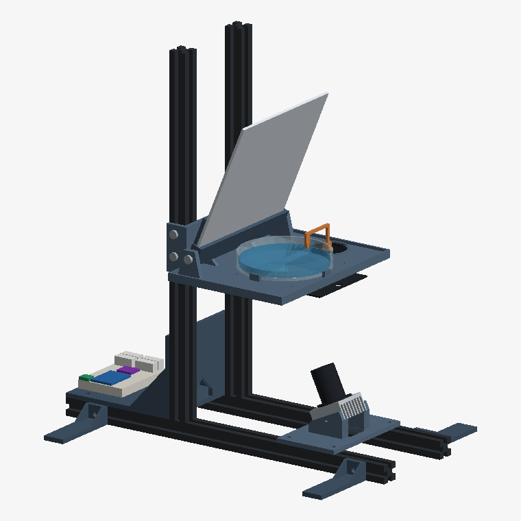

# Caustic

A desk rig that makes moving caustic light patterns, the rippling light you see on the bottom of a pool.
A 3 W LED shines up through a dish of water. A small speaker under the dish taps the water to make ripples,
and a tilting mirror throws the pattern onto a wall or ceiling. An ESP32 controls the LED brightness
and the ripple frequency.

## Status

| Area | State |
|---|---|
| CAD (revision 2) | Done. 15 print files, checked in software. Nothing printed yet. |
| Printing | In progress on the Bambu P1S. |
| Firmware | Done, flashed to the ESP32. Wi-Fi control page and serial commands working. Not yet tested with real loads. |
| Electronics | Waiting on the DRV8833 driver board. |
| Assembly and light tests | Not started. |

## Quick start

1. Wire it up using the [wiring diagram](docs/wiring.md).
2. On your phone, join the Wi-Fi network **Caustic-Rig** (password **causticrig**) and open **http://192.168.4.1**.
3. Use the sliders to set the light and ripples. See [docs/control-page.md](docs/control-page.md).

## Repo layout

| Folder | What is in it |
|---|---|
| [`docs/`](docs/) | Everything you need to build it: [parts list](docs/parts-list.md), [wiring](docs/wiring.md), [control page](docs/control-page.md), [assembly](docs/assembly.md), [firmware](docs/firmware.md), [testing](docs/testing.md), [design notes](docs/design-notes.md). |
| [`firmware/`](firmware/) | `caustic_rig/` is the main firmware. `led_test/` is a simple sketch that only dims the LED. |
| [`cad/`](cad/) | `stl/` and `step/` print files, the full `assembly/` as STEP, the parametric `source/` scripts and `previews/`. See [cad/README.md](cad/README.md). |
| [`archive/`](archive/) | The earlier SolidWorks caustic lamp (v1 and v2 assemblies, June 2026). |

## Build order

1. Print the parts. See [docs/assembly.md](docs/assembly.md#printing). Small parts first, the stage last.
2. Gather the parts on the [parts list](docs/parts-list.md).
3. Wire the electronics on the breadboard. See [docs/wiring.md](docs/wiring.md).
4. Flash the firmware if it isn't already on the board. See [docs/firmware.md](docs/firmware.md).
5. Bench test the LED and speaker before mounting anything. See [docs/testing.md](docs/testing.md).
6. Assemble the frame, stage, mirror and light. See [docs/assembly.md](docs/assembly.md).
7. Run the light tests in [docs/testing.md](docs/testing.md#rig-tests).

## Key numbers

| | |
|---|---|
| Frame | Four 2020 aluminium extrusions, 400 mm. 420 mm tall |
| Footprint | 400 x 280 mm with the outrigger feet |
| Printed parts | 15 files, 18 pieces, about 436 g |
| LED to water | 156 mm along the beam, leaning 25 degrees back |
| Mirror tilt | 60 to 75 degrees, throwing the pattern 5 to 35 degrees upward |
| Pattern at 1 m | About 0.70 x 0.43 m, about 17 lux (estimate) |
| Power | 5 V USB charger into the ESP32, 2 A or more (draws about 1.1 A) |
