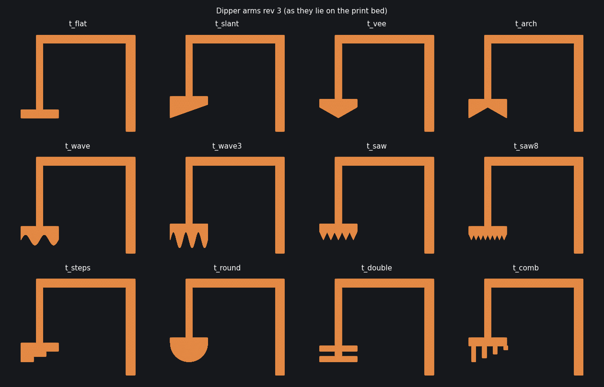

# Dipper arms, rev 3

Twelve tips based on the T that worked best in testing. Built by [`source/dippers_v2.py`](../../source/dippers_v2.py).

- **Tighter fit:** the riser is 3.3 mm square, which leaves 0.05 mm a side in the existing foot socket (rev 2 left 0.2 mm). It's a snug push fit, so the arm doesn't wobble out. If it's too tight, sand the riser lightly.
- **Lower reach:** every tip reaches 12.7 mm (half an inch) lower than the rev 2 arms. The riser length is the same as rev 2, so treat it the same way: if you trimmed the old riser, trim the new ones by the same amount.
- **Level tolerance:** most tips have an uneven underside, so some part of the tip touches the water across 3 to 5 mm of water level.
- Print flat as they come: PLA, 0.2 mm layers, 100% infill, no supports. `all_12_plate.stl` has all twelve on one plate.

| File | Tip |
|---|---|
| `t_flat` | The rev 2 T, wider and lower. Baseline. |
| `t_slant` | Bar tilted 5 mm end to end. Wetted length grows smoothly with level. |
| `t_vee` | V underside. One dot that spreads as the level rises. |
| `t_arch` | Ends lower than the middle. Two dots that merge. |
| `t_wave` | Wavy underside, 2 mm deep, two waves. |
| `t_wave3` | Wavy underside, 3 mm deep, three waves. |
| `t_saw` | Five teeth, 3 mm tall. Five interfering point sources. |
| `t_saw8` | Eight fine teeth, 2 mm tall. |
| `t_steps` | Three 2 mm steps. |
| `t_round` | Half-round underside. The smoothest response to level. |
| `t_double` | Two stacked bars 4 mm apart. Works at two levels. |
| `t_comb` | Four tines, each 1.5 mm shorter than the last. |
