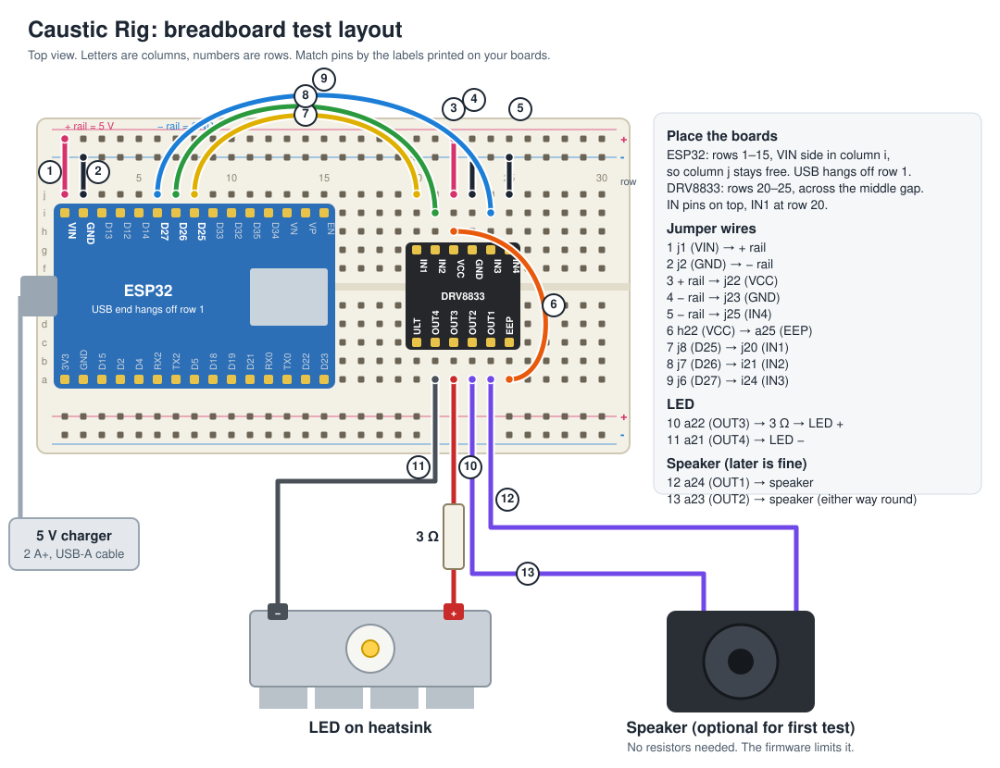

# Breadboard test layout

Use a full-size breadboard. Letters are columns, numbers are rows.

## 1. Place the boards
- **ESP32:** rows 1–15. The **VIN** side goes in column **i**, so column **j** stays free next to each pin. The USB end hangs off past row 1.
- **DRV8833:** rows 20–25, straddling the middle gap. The **IN** pins are on top, with **IN1** at row 20 and **EEP** at the bottom of row 25.
  If its pins land in different columns than shown, use any free hole in the same row.

## 2. Jumper wires
| # | From | To |
|---|---|---|
| 1 | j1 (ESP32 VIN) | top **+** rail |
| 2 | j2 (ESP32 GND) | top **−** rail |
| 3 | top **+** rail | j22 (VCC) |
| 4 | top **−** rail | j23 (GND) |
| 5 | top **−** rail | j25 (IN4) |
| 6 | h22 (VCC) | a25 (EEP) |
| 7 | j8 (D25) | j20 (IN1) |
| 8 | j7 (D26) | i21 (IN2) |
| 9 | j6 (D27) | i24 (IN3) |

## 3. LED
| # | From | To |
|---|---|---|
| 10 | a22 (OUT3) | 3 Ω resistor → LED **+** |
| 11 | a21 (OUT4) | LED **−** |

The cement resistor is too fat for the breadboard. Keep it off the board, inline on the LED's + wire (twist and tape, or solder).

## 4. Speaker (can wait)
| # | From | To |
|---|---|---|
| 12 | a24 (OUT1) | speaker |
| 13 | a23 (OUT2) | speaker's other terminal (either way round) |

No resistors needed. The firmware limits the 4 Ω 3 W speaker.

## 5. Power up
Plug a 5 V, 2 A+ charger into the ESP32. The LED comes on at full brightness (100%). Then open the [control page](control-page.md).

**Note:** EEP is wired to 5 V (VCC) here instead of 3V3. This is within the DRV8833's rating and keeps every ESP32 wire on one side of the board.
