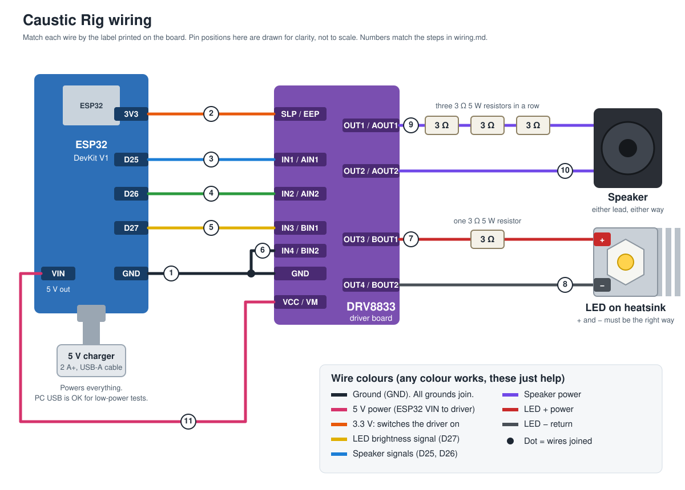

# Wiring

## The idea, simply

- **ESP32 = the brain.** It decides how bright the light is and how fast the water ripples. It only sends tiny signals.
- **DRV8833 = the muscle.** It takes those tiny signals and switches the real power to the LED and the speaker.
- **Charger + USB-C socket = the food.** 5 V power for the LED and speaker.
- **Resistors = the brakes.** They stop too much current from rushing through.
- **Heatsink = the radiator.** The LED gets very hot without it.

Don't wire the ESP32 straight to the LED. A pin gives about 0.02 A, and the LED needs about 0.5 A.

## Before you start

- Unplug everything.
- Stick the LED star onto the heatsink's thermal tape.
- Solder a short wire to each of the LED star's **+** and **−** pads, and to each speaker terminal.
- Push the ESP32 and the DRV8833 into the breadboard so their pins land in separate rows.
- Look at the labels printed on your DRV8833. Cheap boards say **IN1–IN4, OUT1–OUT4, EEP, VCC**. Pololu boards say **AIN1, BIN1, AOUT1, SLP, VIN**. The diagram shows both names.

## Steps

The numbers match the circles on the diagram.

| # | From | To | What it's for |
|---|---|---|---|
| 1 | ESP32 **GND** | DRV8833 **GND** | Shared ground. Everything has to share it. |
| 2 | ESP32 **3V3** | DRV8833 **SLP / EEP** | Switches the driver on |
| 3 | ESP32 **D25** | DRV8833 **IN1 / AIN1** | Speaker signal, first half of the wave |
| 4 | ESP32 **D26** | DRV8833 **IN2 / AIN2** | Speaker signal, second half of the wave |
| 5 | ESP32 **D27** | DRV8833 **IN3 / BIN1** | LED brightness signal |
| 6 | DRV8833 **IN4 / BIN2** | The GND wire from step 1 | Keeps the LED from ever running backwards |
| 7 | DRV8833 **OUT3 / BOUT1** | One **3 Ω** resistor → LED **+** | LED power |
| 8 | LED **−** | DRV8833 **OUT4 / BOUT2** | LED return |
| 9 | DRV8833 **OUT1 / AOUT1** | Three **3 Ω** resistors in a row → speaker | Speaker power |
| 10 | Speaker's other terminal | DRV8833 **OUT2 / AOUT2** | Speaker return. The speaker can go either way round. |
| 11 | USB-C socket **+** | DRV8833 **VCC / VM** | 5 V power |
| 12 | USB-C socket **−** | The GND wire from step 1 | Charger ground joins everything else |

Then:

1. Check the LED's **+** and **−** one more time. Backwards can damage it.
2. Plug the ESP32's USB into your PC, or into any USB charger.
3. Plug the 5 V charger into the USB-C socket.
4. The LED comes on dim, at 10%. Open the control page to adjust it. See [control-page.md](control-page.md).

## Things not to do

- **Don't connect anything to the ESP32's VIN pin** while its USB cable is plugged in. Two power sources can fight.
- Don't run the LED without its heatsink.
- Don't look straight into the LED. It's bright enough to hurt your eyes.
- Keep the breadboard away from the water.

## Running without the PC later

Once everything works, you can power the whole rig from the one charger. Unplug the ESP32's USB cable and add a wire
from the USB-C socket **+** to the ESP32 **VIN** pin. The control page still works over Wi-Fi.

## LED-only test without the driver

To check the LED, resistor and heatsink before the DRV8833 is wired: USB-C **+** → 3 Ω resistor → LED **+**, and LED **−** → USB-C **−**.
The LED runs at full brightness, about 0.5 A, with no dimming. Unplug it if the heatsink gets too hot to hold.
